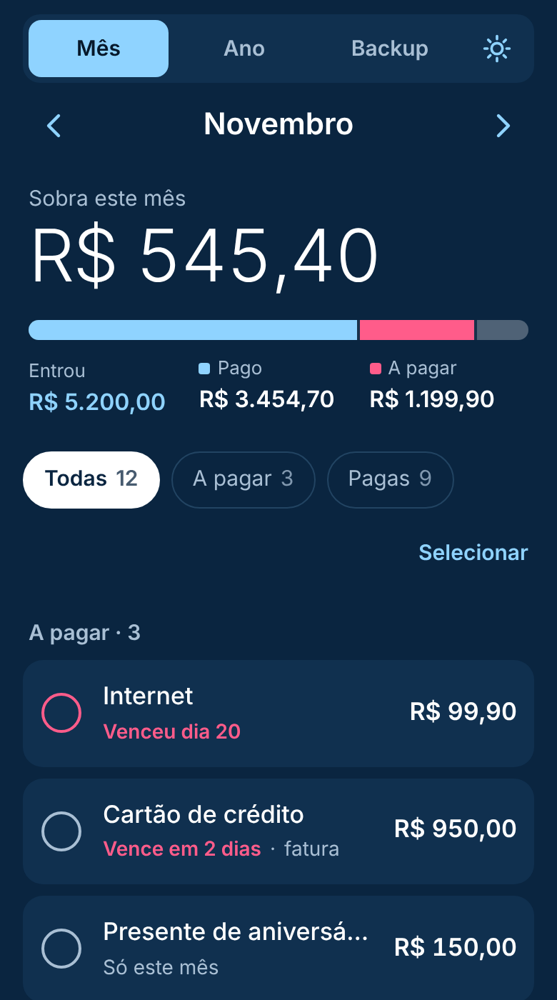
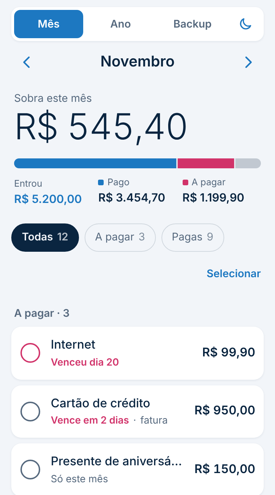
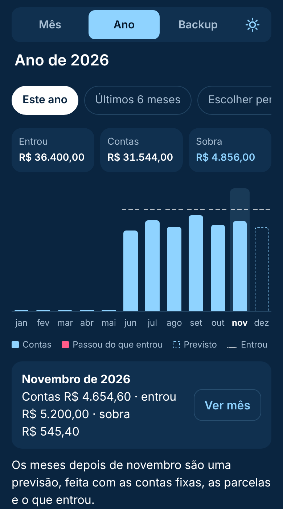
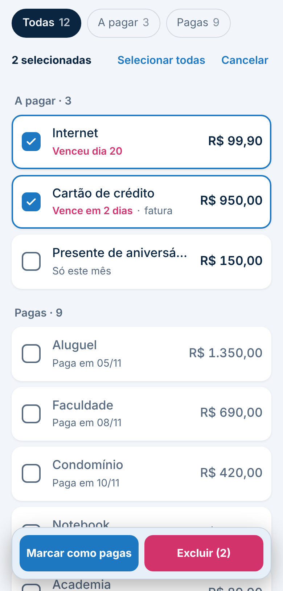
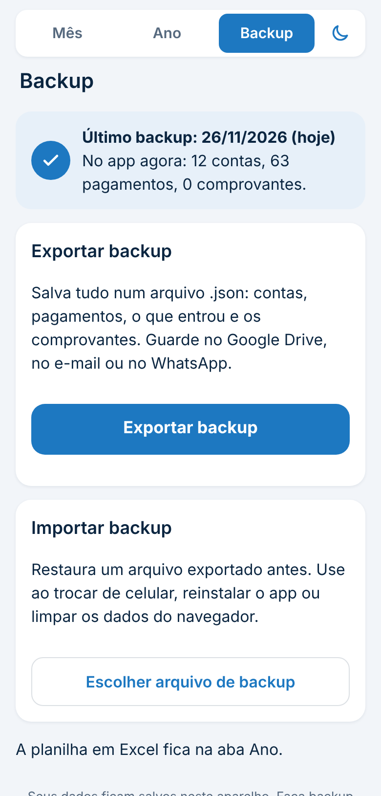

<p align="center">
  
</p>

<h1 align="center">Bolso</h1>

<p align="center">
  As contas do mês no celular: o que já foi pago, o que falta e quanto sobra.<br>
  Funciona sem internet, e os dados ficam só no seu aparelho.
</p>

<p align="center">
  <a href="https://avila-helyf.github.io/bolso/"><b>Abrir o app</b></a>
</p>

<p align="center">
  
  
  
</p>

<p align="center"><sub>Prints com dados de exemplo.</sub></p>

---

## Por que existe

Feito para substituir aquela lista de contas que a gente reescreve todo mês no bloco de notas ou no WhatsApp. No Bolso as contas fixas se repetem sozinhas, as parcelas avançam sozinhas e o topo mostra na hora quanto falta pagar e quanto sobra do que entrou.

## O que ele faz

### Mês
- Contas separadas em **A pagar** e **Pagas**. Um toque no círculo marca como paga.
- Três tipos de conta: **todo mês**, **parcelada** (4/6, 5/6… e some sozinha quando acaba) e **só este mês**.
- Avisos de vencimento, como "Vence em 2 dias" e "Venceu dia 20".
- **Quanto sobra**: informe o que entrou no mês (salário, extras) e veja o que sobra depois das contas.
- **Comprovante** anexado à conta como prova (foto, print ou PDF).
- **Selecionar várias contas** para marcar como pagas ou excluir de uma vez, com opção de desfazer.

### Ano
- Período: este ano, últimos 6 meses ou qualquer intervalo.
- Gráfico com uma barra por mês e a linha do que entrou. Os meses futuros aparecem como previsão.
- Planilha com contas × meses e **exportação para Excel** (.xlsx).

### Backup
- **Exportar backup**: um arquivo .json com tudo, inclusive os comprovantes.
- **Importar backup**: restaura tudo, por exemplo num celular novo.
- Lembrete quando passa de 30 dias sem backup.

### Geral
- Modo claro e modo escuro.
- Instala no Android como app e funciona offline.

<p align="center">
  
  
</p>

## Privacidade

Contas, pagamentos, entradas e comprovantes ficam guardados **só no aparelho**, no armazenamento do navegador (IndexedDB). Nada é enviado para servidor nenhum. Este repositório tem apenas o código do app.

**Atenção:** limpar os dados do Chrome, desinstalar o app ou trocar de celular apaga as informações. Faça backup de vez em quando e guarde o arquivo fora do celular.

## Instalar no Android

1. Abra **https://avila-helyf.github.io/bolso/** no Chrome.
2. Toque em **Instalar** (no aviso azul do app) ou no menu ⋮ → **Instalar app**.
3. Abra o Bolso pelo ícone na tela inicial.
4. Se já tiver um backup, vá em **Backup → Importar backup**.

## Como funciona

| Parte | Tecnologia |
|---|---|
| Telas e lógica | HTML, CSS e JavaScript puro, sem framework, tudo em `index.html` |
| Dados | IndexedDB do navegador |
| Uso offline | Service Worker (`sw.js`) |
| Instalar como app | Web App Manifest (`manifest.webmanifest`) |
| Planilha Excel | [SheetJS](https://sheetjs.com) (`lib/xlsx.mini.min.js`, licença Apache 2.0) |
| Hospedagem | GitHub Pages |

## Estrutura

```
├── index.html            # o app inteiro
├── manifest.webmanifest  # nome, cores e ícones do app instalado
├── sw.js                 # guarda os arquivos para uso offline
├── icons/                # ícones do app
├── lib/                  # SheetJS, para exportar Excel
└── imagens/              # prints deste README
```

## Publicar uma versão nova

1. Envie os arquivos alterados por cima dos antigos (**Add file → Upload files → Commit changes**).
2. Em `sw.js`, aumente a versão do cache: `const CACHE = 'bolso-v2';` vira `'bolso-v3'`, e assim por diante.
3. Ao abrir o app com internet, ele baixa a versão nova sozinho. Os dados continuam no aparelho.

## Formato do backup

<details>
<summary>Ver exemplo do arquivo .json</summary>

```json
{
  "app": "Bolso",
  "formato": 1,
  "exportadoEm": "2026-11-26T12:00:00.000Z",
  "dados": {
    "contas": {
      "c01": { "nome": "Aluguel", "tipo": "fixa", "mesInicio": "2026-11", "dia": 5, "valor": 1350 },
      "c02": { "nome": "Notebook", "tipo": "parcelada", "parcelaInicio": "2026-04", "totalParcelas": 12, "dia": 10, "valor": 289.9 }
    },
    "pags": {
      "c01__2026-11": { "contaId": "c01", "mes": "2026-11", "pago": true, "pagoEm": "2026-11-05", "valor": 1350, "compId": "p01", "compTipo": "img" }
    },
    "meses": {
      "2026-11": { "entradas": [{ "nome": "Salário", "valor": 5200 }] }
    }
  },
  "comprovantes": {
    "p01": { "tipo": "img", "mime": "image/jpeg", "data": "<imagem em base64>" }
  }
}
```

- `tipo` da conta: `fixa` (todo mês), `parcelada` ou `avulsa` (só um mês).
- `pags` guarda o que foi pago em cada mês, com a chave `idDaConta__AAAA-MM`.
- As entradas de um mês se repetem nos meses seguintes até serem alteradas.

</details>

---

<p align="center"><sub>Projeto pessoal, feito com a ajuda do Claude.</sub></p>
